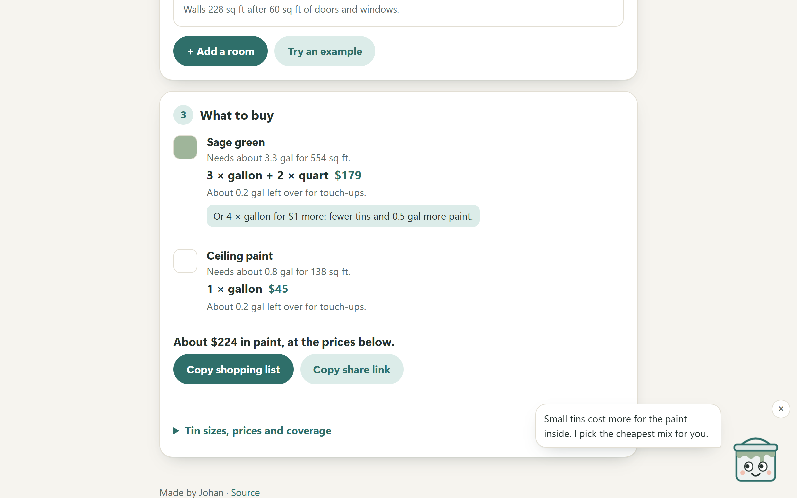

# RoomCoat

How much paint does my room need, and which tins should I buy? Measure the room, and RoomCoat works it out: doors and windows taken off, ceilings in their own white, new plaster and dark-to-light changes counted, and the cheapest mix of tin sizes your shop sells.

**Use it:** https://roomcoat.johanthegoat.xyz



## Why

Most people guess. US paint stewardship studies assume about 10% of all paint sold goes unused, around 80 million gallons a year ([Product Stewardship Institute](https://www.paintcare.org/wp-content/uploads/docs/psi-report-eval-of-CA-stewardship-program-Jan2016.pdf), [Massachusetts EPR background](https://www.mass.gov/doc/epr-commission-background-document-for-policy-recommendation-on-paint/download)), and UK households are sitting on an estimated 139 million litres of it ([Real Homes, Wickes survey](https://www.realhomes.com/us/news/brits-are-storing-139-million-litres-of-unused-paint)). Buying too little is worse: a second trip, and a new tin that may not match.

The online calculators answer "1.7 gallons", which is not something you can buy. The hard part in the shop is the next step: is 3 gallons and 2 quarts cheaper than 4 gallons? (Sometimes by a dollar. RoomCoat tells you both.)

## How it works

- **Area.** Walls are `2 × (length + width) × height`, less 20 sq ft per door and 15 sq ft per window in the US, the sizes common paint calculators use ([Calculator Soup](https://www.calculatorsoup.com/calculators/construction/paint-calculator.php), [Housecall Pro](https://www.housecallpro.com/handyman/templates-calculators/paint-calculator/)). In metric countries a door is a standard 1981 × 762 mm (1.51 m²) and a window 1.2 × 1.2 m.
- **Coverage.** 350 sq ft per US gallon, the low end of the 350–400 printed on most cans; 12 m²/L in the UK, where tins quote "up to 13–14" ([B&Q](https://www.diy.com/departments/dulux-walls-ceilings-egyptian-cotton-matt-emulsion-paint-2-5l/126241_BQ.prd)); 14 m²/L in Australia, where Wash&Wear says 16 ([Mitre 10](https://www.mitre10.com.au/wash-wear-gls-wht-4l)). Type the number from your own tin to override it.
- **Coats.** New plaster or drywall gets a sealing coat: a separate primer in the US and Australia, a thinned mist coat of the same emulsion in the UK. Dark to light adds a top coat.
- **Waste.** 5% on smooth walls and 10% on textured ones, for trays, rollers and cutting in ([Firgelli](https://www.firgelliauto.com/blogs/engineering-calculators/paint-coverage-calculator-area-and-coats)).
- **Tins.** An unbounded knapsack over volume (in mL, reduced by the gcd of the tin sizes) finds the cheapest mix that holds at least what you need. Price ties go to less paint left over. If fewer, bigger tins cost at most 5% more (and no more than the smallest tin), it offers them as an "or".
- **Sizes as people write them.** `12' 6"`, `12 6`, `8' 6 1/2"`, `6½in`, `12ft 6in`, `150in`, `3.6`, `3,6`, `360cm`, `3600mm`. Each box says what it read underneath, so a typo shows up straight away. Switching between feet and metres converts what you typed.
- Rooms with the same paint name share tins. Plans are kept in the browser and can be shared as a link (the plan is in the URL fragment).

## Dab

Dab is the paint tin in the corner. Dab wears the colour you pick for your walls, follows your pointer or the box you're typing in, gives a tip for the step you're on when you tap, frowns when a size can't be right (a 240 ft wall), and reacts when you tick new plaster, a ceiling or a big colour change. Tap five times fast and paint goes everywhere. The × tucks Dab away. Everything Dab says is read out by screen readers, and Dab sits still if you've asked for less motion.

## Run it

Open `index.html`. No build step.

```
npm test
```

runs the engine tests on Node 20, 22 and 24 (also in CI).

MIT licence.
